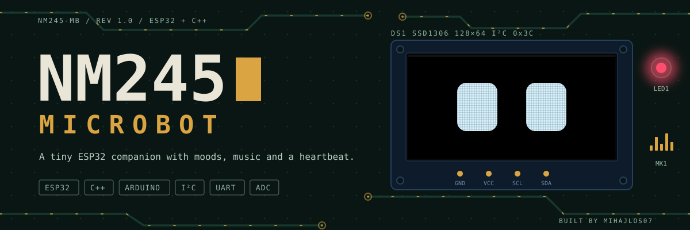
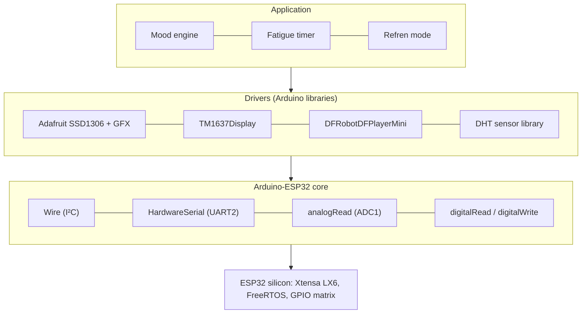
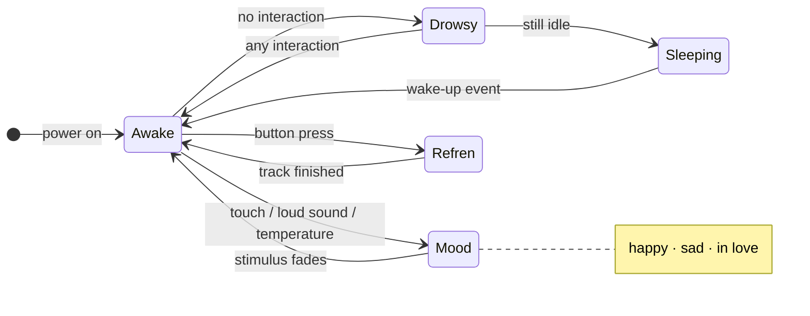
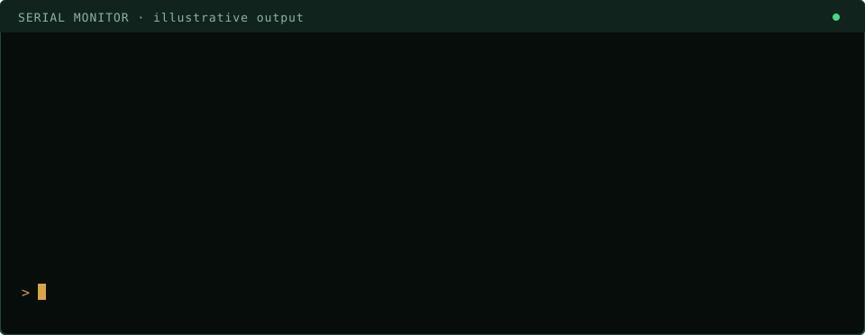
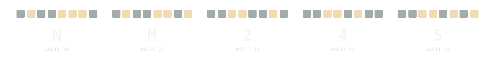

<p align="center">
  
</p>

<p align="center">
  <a href="https://www.arduino.cc/"></a>
  <a href="https://www.espressif.com/en/products/socs/esp32"></a>
  <a href="https://isocpp.org/"></a>
  <a href="https://www.kicad.org/"></a>
  
  <a href="LICENSE"></a>
</p>

<p align="center">
  <b>An interactive desk companion built on the ESP32.</b><br>
  It sees with an OLED, hears with a microphone, feels touch and temperature, and answers with eyes, light, sound and numbers.
</p>

<p align="center">
  <a href="#overview">Overview</a> ·
  <a href="#moods">Moods</a> ·
  <a href="#hardware">Hardware</a> ·
  <a href="#system-architecture">Architecture</a> ·
  <a href="#engineering-notes">Engineering notes</a> ·
  <a href="#schematic">Schematic</a> ·
  <a href="#getting-started">Getting started</a> ·
  <a href="#story">Story</a>
</p>

<p align="center"></p>

## Overview

**NM245 Microbot** is a small embedded system whose whole job is to feel alive. An **ESP32 Dev Module** reads five kinds of input (touch, sound, temperature, a button and the passage of time), decides how it "feels", and expresses that mood through **four output channels at once**: animated OLED eyes, an RGB LED, sound effects and music from a speaker, and a 4-digit 7-segment display.

It is written in **C++ on the Arduino framework** and ties together I²C, UART, ADC, 1-Wire and plain GPIO in a single firmware. The goal was to take the pieces every embedded engineer knows separately (drivers, sensors, timing, state) and combine them into something with personality.

<table>
  <tr>
    <td align="center" width="25%"><b>8</b><br><sub>peripherals on one board</sub></td>
    <td align="center" width="25%"><b>5</b><br><sub>bus types: I²C · UART · ADC · 1-Wire · GPIO</sub></td>
    <td align="center" width="25%"><b>4</b><br><sub>output channels: eyes · light · sound · digits</sub></td>
    <td align="center" width="25%"><b>1</b><br><sub>MCU, no external controller</sub></td>
  </tr>
</table>

### What it does

| Expressive | Aware | Alive |
|---|---|---|
| Eyes on a 128×64 OLED show happy, sad, tired and in-love states. An RGB LED colour-codes the mood, and sounds and music add voice. | Reacts to **touch**, **loud sounds** and **ambient temperature** in real time. | A fatigue model: after a period of inactivity it gets drowsy and falls asleep. Any interaction brings it back. |

<p align="center"></p>

## Moods

The same hardware, four different personalities. The panel that lights up is the one currently "active"; the dot underneath is the cycle timeline.

<p align="center">
  
</p>

### Input → reaction

| Stimulus | Sensor | What the robot does |
|---|---|---|
| Touch | TTP223 capacitive pad | Affection: mood shifts, eyes and LED respond |
| Loud sound | KY-037 microphone | Noticed immediately, reaction on eyes and speaker |
| Room temperature | DHT11 | Slowly influences mood; value can be shown on the TM1637 |
| Long silence | internal timer | Gets tired, eyes droop, then it goes to sleep |
| Button press | Push button | **Refren mode:** music plays and the eyes dance |

<p align="center"></p>

## Hardware

| # | Component | Interface | Role |
|---|---|---|---|
| 1 | **ESP32 Dev Module** | n/a | Main controller (dual-core Xtensa LX6, 240 MHz) |
| 2 | **SSD1306 OLED, 128×64** | I²C | Expressive eyes and emotional states |
| 3 | **TM1637 4-digit display** | 2-wire (CLK/DIO) | Numeric and short text output |
| 4 | **DFPlayer Mini + speaker + microSD** | UART | Sound effects, voice reactions and music |
| 5 | **TTP223 touch sensor** | Digital GPIO | Tactile interaction |
| 6 | **KY-037 microphone sensor** | Analog (ADC1) | Detects loud sounds |
| 7 | **DHT11** | Single-wire | Ambient temperature, influences mood |
| 8 | **RGB LED (common anode)** | 3× GPIO | Mood colour |
| 9 | **Push button** | Digital GPIO | Triggers *refren mode* |

### Pinout

| Signal | ESP32 pin | Notes |
|---|---|---|
| OLED SDA | **GPIO21** | Default I²C data |
| OLED SCL | **GPIO22** | Default I²C clock |
| TM1637 CLK | **GPIO18** | |
| TM1637 DIO | **GPIO19** | |
| DFPlayer TX → ESP32 RX | **GPIO16** | UART2 RX |
| ESP32 TX → DFPlayer RX | **GPIO17** | UART2 TX, through a series resistor (≈2 kΩ as built) |
| Touch sensor (TTP223) | **GPIO4** | Digital input |
| Sound sensor (KY-037, AO) | **GPIO34** | ADC1, input-only pin |
| DHT11 data | **GPIO23** | |
| RGB LED R / G / B | **GPIO25 / 26 / 27** | Common anode (active-low) |
| Music button | **GPIO15** | Refren mode |

<p align="center"></p>

## System architecture

Everything follows one idea: **Sense → Think → Express**. Signals flow left to right; the firmware's main loop is the "Think" in the middle.

<p align="center">
  
</p>

### Software layers



### Behaviour model



<p align="center"></p>

## Engineering notes

<details>
<summary><b>Decisions and gotchas behind the hardware (click to expand)</b></summary>

<br>

| Topic | Note |
|---|---|
| **ADC choice** | The microphone is on **GPIO34 (ADC1)**. ADC2 channels cannot be used while Wi-Fi is active, so ADC1 keeps the door open for future wireless features. |
| **Input-only pin** | GPIO34 has no output driver and no internal pull-up/pull-down, which is fine for an analog sensor but means it cannot be reused as a general output. |
| **Common-anode RGB** | The LED's common pin goes to 3.3 V, so a channel is **on when its pin is LOW**. Colour values must be inverted in software. |
| **DFPlayer UART** | Use **UART2** (GPIO16/17), leaving UART0 free for flashing and the serial monitor. A series resistor on ESP32 TX → DFPlayer RX protects the module's input. |
| **DFPlayer storage** | Needs a **FAT32 microSD card** with numbered files (for example `0001.mp3`). No card means no sound, even if the wiring is perfect. |
| **DHT11 limits** | Roughly ±2 °C accuracy and no more than about one reading per second. Read it on a timer, not on every loop pass. |
| **Strapping pin** | GPIO15 is a boot-strapping pin. Do not hold the button during reset or flashing. |
| **Power** | Supply a stable **5 V into VIN** (USB or a Li-ion pack with a regulator). Speaker bursts cause current spikes; a decoupling capacitor near the DFPlayer helps avoid brown-outs. |
| **I²C** | SSD1306 modules normally answer at address `0x3C`. If the screen stays blank, check the address and the SDA/SCL order first. |

</details>

<p align="center"></p>

## Schematic

### Assembly diagram

<p align="center">
  
</p>

*Wiring, connectors, power distribution and mounting points.*

### Circuit schematic

<p align="center">
  
</p>

*Full ESP32 connections with sensors, displays, DFPlayer Mini and RGB LED.*

## Robot gallery

<table>
  <tr>
    <td></td>
    <td></td>
    <td></td>
  </tr>
  <tr>
    <td></td>
    <td></td>
    <td></td>
  </tr>
</table>

<p align="center"></p>

## Serial monitor

A typical session (illustrative output) from boot to sleep:

<p align="center">
  
</p>

## Getting started

### 1. Prerequisites

- **Arduino IDE** 2.x ([download](https://www.arduino.cc/en/software))
- **ESP32 board support**: in *Boards Manager* install **esp32 by Espressif Systems**
- A USB data cable (not charge-only)

### 2. Clone

```bash
git clone https://github.com/MIhajloS07/ESP32-Microbot.git
cd ESP32-Microbot
```

### 3. Install libraries

| Library | Purpose |
|---|---|
| `Adafruit SSD1306` | OLED driver |
| `Adafruit GFX Library` | Graphics primitives for the eyes |
| `TM1637Display` | 7-segment display |
| `DFRobotDFPlayerMini` | Audio player control |
| `DHT sensor library` | Temperature sensor (also install **Adafruit Unified Sensor**) |

### 4. Prepare the SD card

Format a microSD card as **FAT32**, copy your audio files with numbered names (`0001.mp3`, `0002.mp3`, …) and insert it into the DFPlayer Mini.

### 5. Build the hardware

Follow the [pinout](#pinout), the [assembly diagram](#assembly-diagram) and the [circuit schematic](#circuit-schematic).

### 6. Flash

1. Open the sketch in Arduino IDE.
2. **Tools → Board → ESP32 Dev Module**
3. **Tools → Port →** your COM port
4. Click **Upload**. If it hangs on *Connecting…*, hold the board's **BOOT** button until the upload starts.

### Troubleshooting

| Symptom | Likely cause and fix |
|---|---|
| OLED stays blank | Wrong I²C address (try `0x3C` / `0x3D`) or SDA/SCL swapped |
| No sound | microSD not FAT32, wrong file names, or TX/RX crossed (ESP32 TX goes to DFPlayer **RX**) |
| Upload fails with *Failed to connect* | Hold **BOOT** while uploading; check the USB cable |
| COM port missing | Install the USB-UART driver (CP210x or CH340, depending on your board) |
| Random resets when sound plays | Weak 5 V supply; use a better source and add a capacitor near the DFPlayer |
| Temperature reads `NaN` | Check DHT11 wiring and read it no more often than once per second |
| LED colours look inverted | Common-anode LED: a channel is ON when its pin is LOW |

<p align="center"></p>

## Story

<p align="center">
  
</p>

The NM245 Microbot is not just a technical project. It was born as a **gift for someone special**.

I wanted to build more than a robot: a digital representation of myself, a symbolic presence that can stay close even when I am not physically there. Every sensor, every LED colour and every sound effect was chosen to reflect an emotion, a reaction, a piece of personality. The OLED eyes show happiness, sadness or fatigue, just like me. The DFPlayer Mini plays music to bring joy, and the RGB LED glows in the colour of the mood.

Together they form a small digital being, a companion written in the language of **010101**.

> *"Here I am, represented in circuits and algorithms, a digital version of myself created for you."*

## Roadmap

- [x] Animated OLED eyes with multiple emotions
- [x] Touch, sound and temperature awareness
- [x] Fatigue and sleep behaviour
- [x] Refren mode with music and dancing eyes
- [ ] Wi-Fi / Bluetooth features (the ESP32 radios are currently unused)
- [ ] Cloud connectivity and remote mood control
- [ ] Battery pack with charging circuit
- [ ] 3D-printed enclosure
- [ ] Custom PCB in KiCad

## FAQ

<details>
<summary><b>Can the Microbot run on batteries?</b></summary>
Yes. A Li-ion pack or a USB power bank works, as long as it delivers a stable 5 V to <b>VIN</b>.
</details>

<details>
<summary><b>Which libraries are required?</b></summary>
Adafruit SSD1306, Adafruit GFX, TM1637Display, DFRobotDFPlayerMini and the DHT sensor library (plus Adafruit Unified Sensor).
</details>

<details>
<summary><b>Can I customize the emotions?</b></summary>
Absolutely. The OLED animations and RGB LED colours are fully programmable in the code.
</details>

<details>
<summary><b>Does it use Wi-Fi or Bluetooth?</b></summary>
The ESP32 has both built in, but this version does not use them yet. Future versions may add cloud connectivity.
</details>

<details>
<summary><b>How do I upload the code?</b></summary>
Open the project in Arduino IDE, select <i>ESP32 Dev Module</i>, choose the COM port and click <i>Upload</i>.
</details>

<details>
<summary><b>Can I add more sensors or modules?</b></summary>
Yes. The ESP32 has plenty of free GPIO pins; extend the schematic with new inputs or outputs.
</details>

## Feedback

Questions, ideas or improvements are welcome: open an issue or write to **mihajlostoiljkovic554@gmail.com**.

## License

Released under the **MIT License**. See [LICENSE](LICENSE) for details.

<p align="center"></p>

<p align="center">
  <sub>Made with solder, C++ and a bit of heart · <a href="https://github.com/MIhajloS07">@MIhajloS07</a></sub>
</p>
